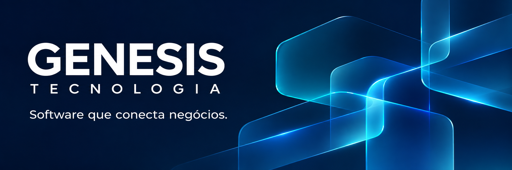

  

<h1 align="center">Genesis Tecnologia</h1>

  Soluções digitais para simplificar operações e conectar empresas ao futuro.

  <a href="https://github.com/genesisenterprisedev?tab=repositories">Projetos</a>
  &nbsp;·&nbsp;
  <a href="mailto:genesisenterprise.dev@gmail.com">Fale com a gente</a>

## O que fazemos

Desenvolvemos software para gestão empresarial, automação de processos e inteligência artificial aplicada aos negócios. Conectamos aplicações, dados e serviços para tornar a operação das empresas mais simples e integrada.

- **Gestão empresarial:** sistemas para organizar clientes, contratos, atendimento e operações.
- **Inteligência artificial:** agentes especializados, análise de documentos e apoio a rotinas fiscais.
- **Integrações e aplicações:** APIs e experiências web, mobile e desktop conectadas aos processos do negócio.

## Projetos em destaque

| Projeto | Foco |
| --- | --- |
| [Zeus Enterprise Manager](https://github.com/genesisenterprisedev/zeus-Enterprise-Manager) | Gestão de clientes, contratos, chamados, equipamentos e agenda técnica. |
| [Genesis Agente Tributário IA](https://github.com/genesisenterprisedev/genesis-agente-tributario-ia) | Assistentes especializados para consulta tributária, análise documental e geração de código. |

## Nossa engenharia

Trabalhamos com **TypeScript, React, Kotlin, Python e Rust**, além de APIs, bancos de dados e infraestrutura em nuvem. Escolhemos as tecnologias conforme as necessidades de cada solução, com foco em manutenção, segurança e evolução contínua.

---

  <strong>Vamos transformar uma necessidade do seu negócio em software?</strong> 
  <a href="mailto:genesisenterprise.dev@gmail.com">genesisenterprise.dev@gmail.com</a>

